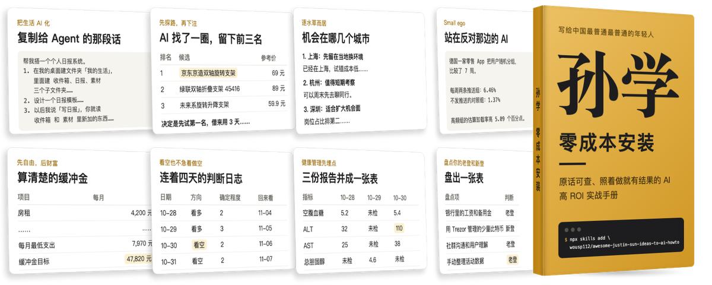

  

<h1 align="center">Sun Xue, Zero-Cost Install</h1>

  High-ROI AI how-tos built on Justin Sun's own words, with source timestamps and practical results

  
  

  
  
  
  
  

  <a href="README.md">简体中文</a>
  ｜
  English
  ｜
  <a href="https://x.com/qi9098">X (@qi9098)</a>

## About this book

"Sun Xue" is what Justin Sun calls his own way of thinking. He says its best feature is that it installs at zero cost, like distilling a skill into an AI. This repo takes the ideas from two Chinese interviews with him and turns them into 25 step-by-step AI how-tos and a skill you can install into your own AI. More updates and discussions live on X at [@qi9098](https://x.com/qi9098).

| Interview | Host | Length | What it covers |
| --- | --- | --- | --- |
| [How young people can win in the AI era](https://www.youtube.com/watch?v=0Z-vhBvBmUY) | [Alan Shao @AlanShao111](https://x.com/AlanShao111) | 4 h 22 min | Using AI in daily life, cross-border pricing arbitrage, free GPU compute, health, freedom |
| [The AI golden age: where should ordinary people bet?](https://www.youtube.com/watch?v=o9Jn__LGGI4) | William Joy (金明) | 47 min | Quantum risk to Bitcoin, US debt, AI applications, health data, his own positions |

| If you want to | Open |
| --- | --- |
| Get a plan from your AI | [AGENT.md](AGENT.md). Copy it to Claude, ChatGPT, or Codex, then describe your situation. Your AI will reply in your language. |
| Install it as a skill | Run `npx skills add wousp112/awesome-justin-sun-ideas-to-ai-howto`. It works with Claude Code, Codex, and other agents that read skills. |
| Check the newest high-ROI guides | [1.16 Cross-border pricing](邵艾伦/guides/16-跨境差价.md) (Google One AI Ultra intro pricing) and [1.17 Free compute](邵艾伦/guides/17-免费算力.md) (Colab / ModelScope free GPUs) |
| See both interviews on one page | [思维导图.md](思维导图.md), the mind map (Chinese) |
| Follow step-by-step guides | [Alan Shao guides](邵艾伦/guides/) (17) and [William Joy guides](金明/guides/) (8), with tool picks and a prompt for your agent (Chinese) |
| Compare tools | [工具总表.md](工具总表.md), every tool in the guides with price and access in mainland China, checked on 2026-11-24 (Chinese) |
| Read the key ideas | [Alan Shao summary](邵艾伦/精华.md) and [William Joy summary](金明/精华.md), with video timestamps (Chinese) |
| Read the full interviews | [Alan Shao transcript](邵艾伦/全文.md) and [William Joy transcript](金明/全文.md), timestamped, with a topic index and a list of corrections (Chinese) |

Both transcripts were made with Gemini and spot-checked against the audio. Check names and exact quotes against the video before you cite them. Justin Sun's views and positions in the second interview are his own. The guides teach you to record and review your own judgments, not what to buy or sell.

License: everything except the two transcripts is CC BY 4.0. The interviews belong to their original creators. See [LICENSE](LICENSE).
