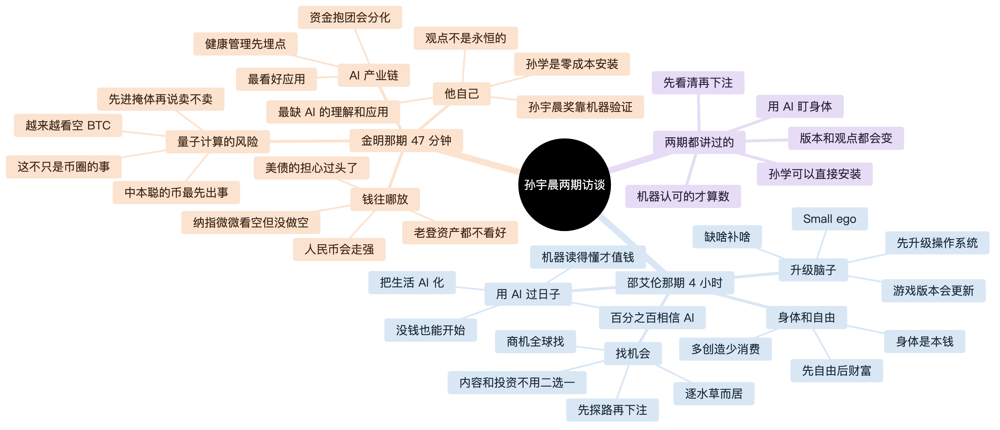

# 孙宇晨的观点，用 AI 落地

[English](README.en.md)

孙宇晨最近上了两期访谈。邵艾伦那期 4 小时 22 分钟，聊年轻人怎么用 AI 抓住机会。金明那期 47 分钟，聊 AI 时代钱往哪放。两期我们都转成了带时间戳的全文，挑出观点，能动手的观点每个配了一篇教程，写清楚怎么一步步做、用什么工具。观点是孙宇晨的，用哪个 AI 工具、按什么步骤去做，是我们配的。

## 从哪看起

| 你想 | 看这个 |
| --- | --- |
| 让 AI 替你出主意 | 把 [AGENT.md](AGENT.md) 复制给你的 AI，再说说你的情况 |
| 自己动手试 | 先看 [00 准备](邵艾伦/guides/00-准备.md) 装好 AI，再从下面挑一篇 |
| 一张图看完两期 | [思维导图](思维导图.md) |
| 只看重点 | [邵艾伦那期精华](邵艾伦/精华.md)、[金明那期精华](金明/精华.md) |
| 看原话 | [邵艾伦那期全文](邵艾伦/全文.md)、[金明那期全文](金明/全文.md) |

教程表里的「推荐」是我们觉得最好用的工具，「国内」是不用海外手机号和信用卡就能开的替代品。每篇教程开头是孙宇晨的原话和视频时间点，后面是按先后顺序写的做法，每一步花多久看你自己。最后一段是写给 AI 的话，整段复制给你的 Agent，它会照着帮你装软件、建文件夹。

## 邵艾伦那期：年轻人如何抓住 AI 时代的机会？

原视频：[YouTube](https://www.youtube.com/watch?v=0Z-vhBvBmUY) · 主持人：[邵艾伦 @AlanShao111](https://x.com/AlanShao111) · 4 小时 22 分钟

| | 观点 | 从哪下手 | 推荐 | 国内 |
| --- | --- | --- | --- | --- |
| 01 | [把生活 AI 化](邵艾伦/guides/01-生活AI化.md) | 建一个文件夹，让 AI 每天替你写日报 | Claude Code / Codex、Obsidian、Oura | Kimi Code、思源笔记、Zepp |
| 02 | [没钱也能开始](邵艾伦/guides/02-没钱也能开始.md) | 挑一件经常重复的事，用免费额度交给 AI | Gemini CLI（有免费额度） | Kimi Code、Qwen Code |
| 03 | [先升级操作系统](邵艾伦/guides/03-升级操作系统.md) | 写下一个看法，找资料来验证它 | Obsidian、NotebookLM | 思源笔记、Kimi |
| 04 | [百分之百相信 AI](邵艾伦/guides/04-百分之百相信AI.md) | 同一个问题问三个模型，挑最好的去做 | ChatHub、Arena | Kimi、通义、智谱各问一遍 |
| 05 | [商机全球找](邵艾伦/guides/05-商机全球找.md) | 去海外论坛看看你这行的人在抱怨什么 | Google Trends、Shopify、Wise | 店匠、空中云汇、万里汇 |
| 06 | [先探路，再下注](邵艾伦/guides/06-先探路再下注.md) | 多找几个候选，挑出最好的先试一下 | Perplexity、Airtable | 秘塔搜索、飞书多维表格 |
| 07 | [身体是本钱](邵艾伦/guides/07-身体是本钱.md) | 把手环数据交给 AI，让它盯着趋势 | Oura / WHOOP、Apple 健康 | Zepp / 华为、Keep |
| 08 | [逐水草而居](邵艾伦/guides/08-逐水草而居.md) | 搞清楚你要的机会大多在哪个城市 | Nomads.com、Levels.fyi | 脉脉、电鸭社区 |
| 09 | [机器读得懂才值钱](邵艾伦/guides/09-机器读得懂.md) | 把常用资料转成 AI 能读的 Markdown | MarkItDown、OCRmyPDF | MinerU |
| 10 | [内容和投资不用二选一](邵艾伦/guides/10-内容和投资.md) | 内容和投资分两个文件夹，各记各的 | Ghost / beehiiv、Portfolio Performance | 公众号、本地记账 |
| 11 | [Small ego](邵艾伦/guides/11-small-ego.md) | 让 AI 站在反对者那边反驳你 | Decision Journal 方法 | 同左，任何笔记工具 |
| 12 | [先自由，后财富](邵艾伦/guides/12-先自由后财富.md) | 翻一遍账单，算出你的缓冲金 | YNAB / Actual Budget | 钱迹、随手记 |
| 13 | [游戏版本会更新](邵艾伦/guides/13-游戏版本更新.md) | 订阅几个一手信息源，让 AI 帮你看变化 | Folo、GitHub Trending、Awesome 列表 | Folo |
| 14 | [缺啥补啥](邵艾伦/guides/14-缺啥补啥.md) | 给自己出一道目标岗位的模拟题 | Forage、ADPList | 牛客、即刻 / 脉脉找人聊 |
| 15 | [多创造，少消费](邵艾伦/guides/15-多创造少消费.md) | 把刚搞懂的东西写成教程发出去 | GitHub Pages、Quartz | 公众号、B 站 |

## 金明那期：AI 黄金时代，普通人如何下注？

原视频：[YouTube](https://www.youtube.com/watch?v=o9Jn__LGGI4) · 主持人：金明（William Joy，圈内叫他仙道） · 47 分钟

这期一半在聊仓位和市场。访谈里的判断都是孙宇晨自己的，教程只教你用 AI 记录、研究和复盘，不教买卖。

| | 观点 | 从哪下手 | 推荐 | 国内 |
| --- | --- | --- | --- | --- |
| 01 | [从不关注到密切关注](金明/guides/01-密切关注.md) | 给一件长期风险找几个信号，订阅一手来源 | arXiv、BIP-360、Folo | Folo |
| 02 | [把币放进没签过名的地址](金明/guides/02-币进掩体.md) | 查一遍自己的地址有没有提前暴露公钥 | mempool.space、Sparrow、Trezor | OneKey |
| 03 | [看空也不急着做空](金明/guides/03-判断日志.md) | 判断和仓位分开记，隔一段时间对答案 | Obsidian、Portfolio Performance | 思源笔记、飞书多维表格 |
| 04 | [健康管理先埋点](金明/guides/04-健康先埋点.md) | 把体检报告整理成一张表，带着问题去见医生 | MinerU、Oura、Apple 健康 | MinerU、华为运动健康 |
| 05 | [零成本安装](金明/guides/05-零成本安装.md) | 把一套方法蒸馏成 AI 能装的 skill | Claude Code skill、AGENTS.md | Kimi Code、Qwen Code |
| 06 | [让机器来验证](金明/guides/06-让机器验证.md) | 让 AI 写一个 Lean 证明，交给机器验 | Lean 4 Web、自然数游戏、Mathlib | 同左 |
| 07 | [从数据里找 AI 应用](金明/guides/07-从数据找应用.md) | 在熟悉的场景里找没人好好处理的数据 | Product Hunt、Google Trends | 少数派、百度指数 |
| 08 | [盘点你的老登和新登](金明/guides/08-老登和新登.md) | 把你的钱、技能和信息源盘一遍 | Obsidian | 思源笔记、飞书文档 |

## 全文是怎么做出来的

两期都用 Gemini 3.8 Flash 转录。Gemini 系列在 [Artificial Analysis 语音转文字榜单](https://artificialanalysis.ai/speech-to-text)上排在前十，同系列的 Gemini 3.5 Transcribe 词错误率是 2.6%。

**邵艾伦那期**，原视频 4 小时 22 分 29 秒，YouTube 上没有字幕。我们把音轨切成 57 段，每段 5 分钟，相邻两段重叠 20 秒，防止句子在切口处被截断。第一轮有 5 段没有通过格式检查，我们把它们切成 30 个更短的片段重新转。有一段出现了一长串重复文字，也单独重转了一遍。最后得到约 12 万字，1,743 条发言。

**金明那期**，原视频 47 分 08 秒，切成 11 段，同样每段 5 分钟、重叠 20 秒。转录那晚网络不稳，7 段没转完，我们把这 7 段切成 40 个 1 分钟的小段重新转，相邻两段重叠 10 秒，再按文字把重叠的地方接上，去掉重复的句子。最后得到约 1.2 万字，316 条发言。机器把「孙学」听成了「孙选」，把「孙宇晨奖」听成了「孙正义奖」，把「薄肌」听成了「搏击」，这些都按上下文改了回来。

两期都从开头、中间、结尾各截 30 秒音频，单独再识别一次，拿去和主稿对照，内容和顺序都对得上。每条发言都标了时间，拿着时间就能在视频里找到原话。

还有几处要留意。全文没有逐句人工听校，个别人名和同音词可能有误，引用原话前最好回看视频。邵艾伦那期相邻两段重叠的地方，开头可能有几句重复，文中都标了出来。00:32:40 那段两个人的话被识别成了一整段，没能分开。金明那期开头 1 分 46 秒是正片片段剪成的预告，内容和后面重复。

## 授权

精华、教程、AGENT.md 和思维导图随便用，注明出处就行。访谈内容版权归原作者。详见 [LICENSE](LICENSE)。
