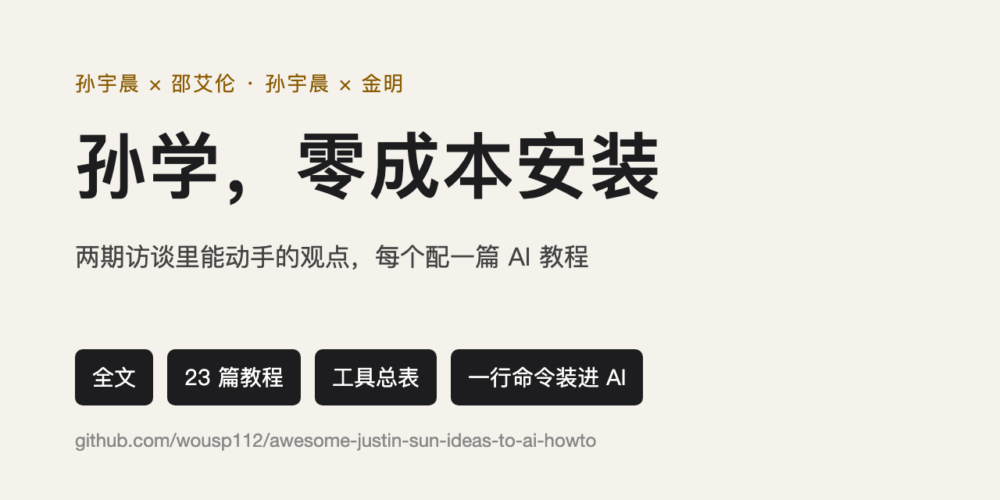
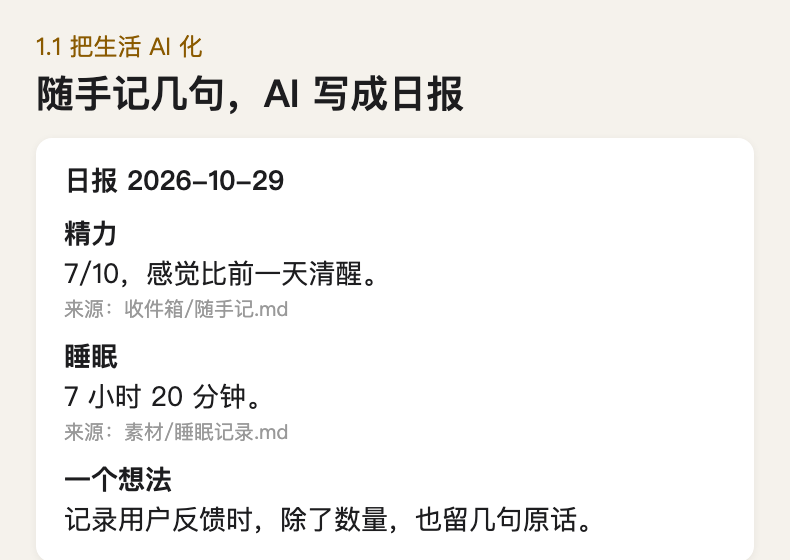
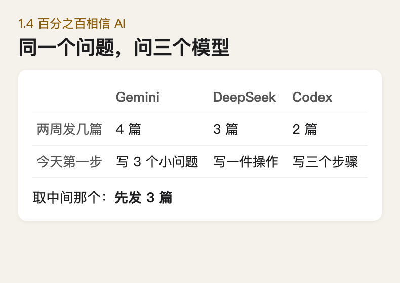

  

  
   
  原话可查、照着做就有结果的 AI 落地教程

  
  

  
  

  
  
  
  
  

  简体中文
  ｜
  <a href="README.en.md">English</a>

## 关于本书

本项目旨在把孙宇晨两期访谈里能动手的观点，做成一本照着就能做的 AI 入门教程。

- 两期访谈都转成了带时间戳的全文，每个观点都能点回视频里的原话。
- 每篇教程配一段写给 AI 的话，复制给 Agent 它就照着做，也有一步步的手动做法。
- 示例结果都是照提示词真跑出来的，每个工具都有国内能直接用的版本。

若本书对你有帮助，请在页面右上角点个 Star :star: 支持一下，谢谢！

## 贡献

本书仍在持续更新，欢迎你参与，一起把内容改得更准。

- [内容修正](https://github.com/wousp112/awesome-justin-sun-ideas-to-ai-howto/issues/new?template=correction.yml)：原话、时间点、链接或价格不对，请指出来。
- [推荐工具](https://github.com/wousp112/awesome-justin-sun-ideas-to-ai-howto/issues/new?template=tool.yml)：写清它对应哪篇教程的哪一步、多少钱、国内能不能用。

写法和提交方式见 [CONTRIBUTING](CONTRIBUTING.md)，每次改了什么记在 [CHANGELOG](CHANGELOG.md)。

感谢本书的每一位撰稿人：

    

## License

除两期 `全文.md` 外，本仓库的文字、图片和提示词采用 [CC BY 4.0](LICENSE) 授权。访谈内容版权归原作者。
