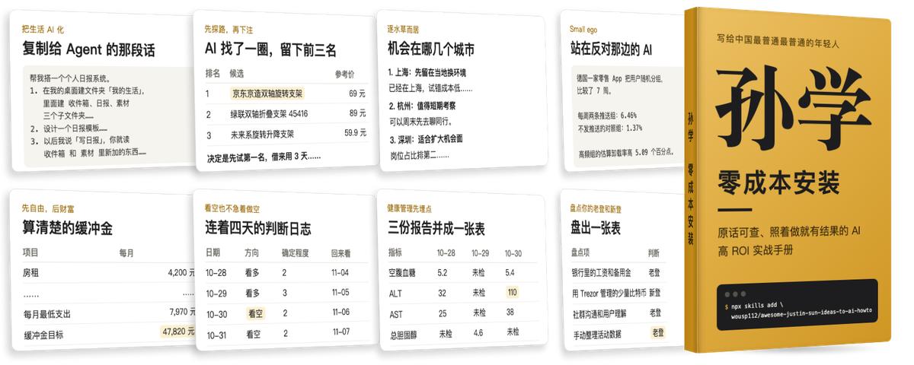
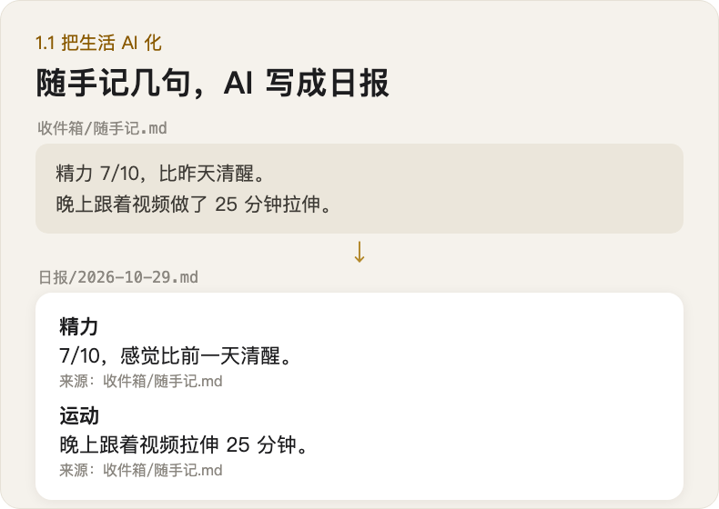
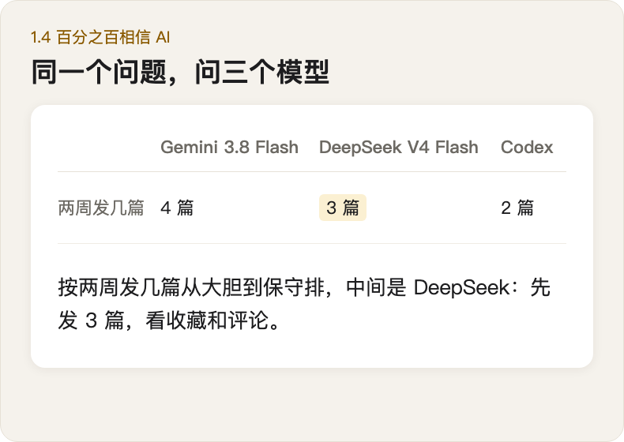

<p align="center">
  <a href="前言.md">
    <picture><source media="(prefers-color-scheme: dark)" srcset="assets/cover_dark.png"></picture></a>
</p>

<p align="center">
  <picture><source media="(prefers-color-scheme: dark)" srcset="https://readme-typing-svg.demolab.com?font=Noto+Sans+SC&weight=500&size=26&duration=3500&pause=2000&color=E0AE45&center=true&vCenter=true&random=false&width=380&height=60&lines=%E5%AD%99%E5%AD%A6%EF%BC%8C%E9%9B%B6%E6%88%90%E6%9C%AC%E5%AE%89%E8%A3%85"></picture>
  </br>
  原话可查、照着做就有结果的 AI 高 ROI 实战手册
</p>

<p align="center">
  <a href="前言.md">
    </a>
  <a href="#装进-agent">
    </a>
</p>

<p align="center">
  <a href="第1章/生活AI化.md"><picture><source media="(prefers-color-scheme: dark)" srcset="assets/demo1_dark.png"></picture></a>
  <a href="第1章/百分之百相信AI.md"><picture><source media="(prefers-color-scheme: dark)" srcset="assets/demo2_dark.png"></picture></a>
</p>

<p align="center">
  
  
  
  
  
</p>

<p align="center">
  简体中文
  ｜
  <a href="README.en.md">English</a>
  ｜
  <a href="前言.md#目录">完整目录</a>
  ｜
  <a href="工具总表.md">工具总表</a>
  ｜
  <a href="https://x.com/qi9098">我的 X</a>
</p>

## 先看这几篇

孙学是孙宇晨自己的一套理论，他的说法是给大脑升级操作系统。这里把孙学里能动手的观点，做成 25 篇照着就能跑的 AI 做法。每篇带视频原话时间点、发给 Agent 的提示词和手动步骤，常用工具都在[工具总表](工具总表.md)标了实测价和国内能不能直接用。

| 想做什么 | 直达 | 你会拿到 |
| --- | --- | --- |
| 找 1 折海外 AI 会员差价 | [3.5 跨境差价](第3章/跨境差价.md) | Google One AI Ultra 原价 199.99 美元/月，前三个月 19.99 的真实差价、门槛和排查法 |
| 零成本蹭显卡跑一次性任务 | [1.6 免费算力](第1章/免费算力.md) | 用 Google Colab 或魔搭免费 GPU 跑通批量转录等重任务，结果回存云盘 |
| 零基础搭好第一个 AI Agent | [0.1 先装一个能动你电脑的 AI](第0章/准备.md) | 装好能读本地文件的 Agent，后面 25 篇都能直接复制提示词跑 |
| 把日常记录变成每日复盘 | [1.1 把生活 AI 化](第1章/生活AI化.md) | 一个本地文件夹加随手记，AI 每天自动写日报 |
| 按价格和国内可用性挑工具 | [工具总表](工具总表.md) | 全书工具一页查完，附核实日期和国内替代方案 |
| 浏览全部 25 篇教程和原话 | [前言与完整目录](前言.md#目录) | 五章 25 节，加两期带时间戳全文和思维导图 |

## 装进 Agent

已经在用 Claude Code、Codex、Gemini CLI 这类 Agent，一行命令就能把整本书的思路装进去：

```bash
npx skills add wousp112/awesome-justin-sun-ideas-to-ai-howto
```

<details>
<summary>没装 Node.js，或者用网页版 AI</summary>

把 [AGENT.md](AGENT.md) 复制给它，或者让能联网的 AI 直接读取：

```text
https://raw.githubusercontent.com/wousp112/awesome-justin-sun-ideas-to-ai-howto/main/AGENT.md
```

</details>

## 更多更新

更多实时更新、实操资源和交流在我的 X：[@qi9098](https://x.com/qi9098)。

若本书对你有帮助，请在页面右上角点个 Star :star: 支持一下，谢谢！

## 贡献

本书仍在持续更新，每月第一个周一照 [巡检清单](CHECKLIST.md) 核一遍价格和链接，欢迎一起把它改得更准。

- [内容修正](https://github.com/wousp112/awesome-justin-sun-ideas-to-ai-howto/issues/new?template=correction.yml)：原话、时间点、链接或价格不对，请指出来。
- [推荐工具](https://github.com/wousp112/awesome-justin-sun-ideas-to-ai-howto/issues/new?template=tool.yml)：写清它对应哪篇教程的哪一步、多少钱、国内能不能用。

写法和提交方式见 [CONTRIBUTING](CONTRIBUTING.md)，每次改了什么记在 [CHANGELOG](CHANGELOG.md)。

感谢本书的每一位撰稿人：

<p align="left">
    <a href="https://github.com/wousp112/awesome-justin-sun-ideas-to-ai-howto/graphs/contributors">
        
    </a>
</p>

## License

除两期 `全文.md` 外，本仓库的文字、图片和提示词采用 [CC BY 4.0](LICENSE) 授权。访谈内容版权归原作者。
