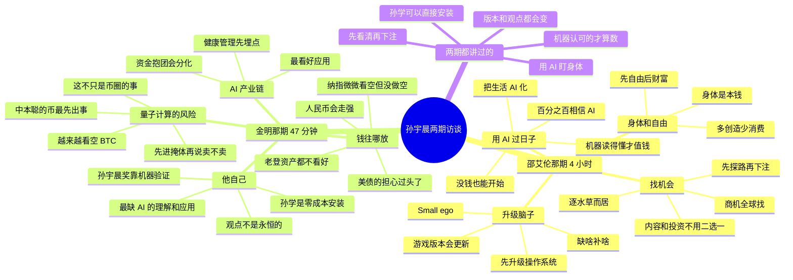

# 思维导图

孙宇晨两期访谈的观点，一张图看完。点进 [邵艾伦那期](邵艾伦/精华.md) 和 [金明那期](金明/精华.md) 能看到每个观点的原话和时间点。想要图片版，打开 [思维导图.png](思维导图.png)。

两期都讲过的，对应关系是这样：

| 主题 | 邵艾伦那期 | 金明那期 |
| --- | --- | --- |
| 用 AI 盯身体 | [身体是本钱](邵艾伦/guides/07-身体是本钱.md) | [健康管理先埋点](金明/guides/04-健康先埋点.md) |
| 孙学可以直接安装 | [先升级操作系统](邵艾伦/guides/03-升级操作系统.md) | [零成本安装](金明/guides/05-零成本安装.md) |
| 机器认可的才算数 | [机器读得懂才值钱](邵艾伦/guides/09-机器读得懂.md) | [让机器来验证](金明/guides/06-让机器验证.md) |
| 先看清再下注 | [先探路，再下注](邵艾伦/guides/06-先探路再下注.md) | 孙宇晨奖先少放钱，像打德扑先看看牌 |
| 版本和观点都会变 | [游戏版本会更新](邵艾伦/guides/13-游戏版本更新.md) | [看空也不急着做空](金明/guides/03-判断日志.md) |
