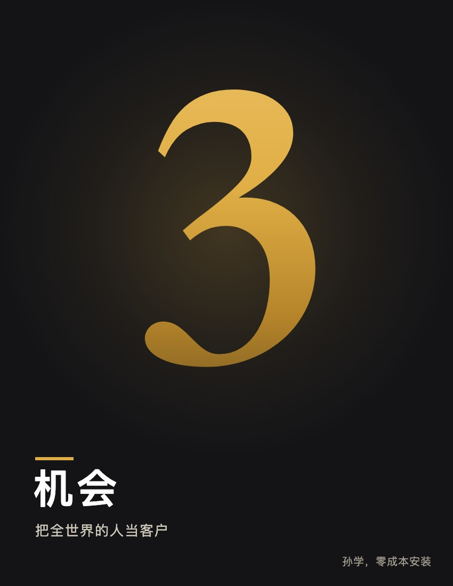

# 第 3 章　机会

  

> 东西卖到全世界，主意、想法卖到全世界
>
> 孙宇晨，[邵艾伦那期 00:37:20](https://www.youtube.com/watch?v=0Z-vhBvBmUY&t=2240s)

## 本章内容

| 节 | 观点 | 做完你会有 |
| --- | --- | --- |
| 3.1 | [商机全球找](商机全球找.md) | 一个海外用户反复抱怨的问题，和一页解决方案 |
| 3.2 | [先探路，再下注](先探路再下注.md) | 一张候选对比表，和第一个要试的 |
| 3.3 | [逐水草而居](逐水草而居.md) | 你这行的机会大多在哪几个城市 |
| 3.4 | [内容和投资不用二选一](内容和投资.md) | 两个文件夹，内容和投资分开记 |
| 3.5 | [跨境差价](跨境差价.md) | 一个自己核过的真实差价，和它的全部成本 |
| 3.6 | [从数据里找 AI 应用](从数据找应用.md) | 一个采了没人用的数据，和能拿它做的事 |
| 3.7 | [小结](小结.md) | 每节的重点回顾和常见问题 |

---

<a href="../第2章/小结.md">← 2.7 小结</a> ｜ <a href="../前言.md#目录">目录</a> ｜ <a href="商机全球找.md">3.1 商机全球找 →</a>

