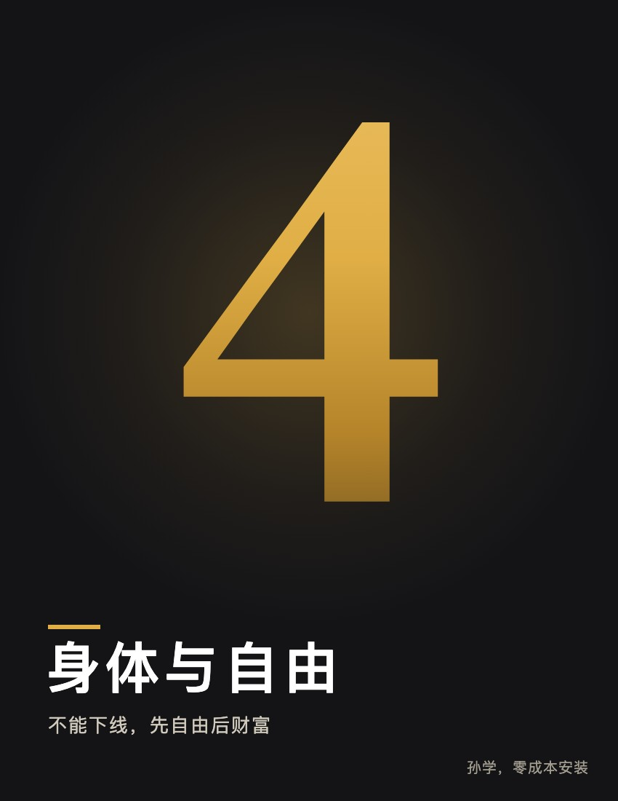

# 第 4 章　身体与自由

  

> 千万不能下线，我们要超长待机
>
> 孙宇晨，[邵艾伦那期 01:00:29](https://www.youtube.com/watch?v=0Z-vhBvBmUY&t=3629s)

## 本章内容

| 节 | 观点 | 做完你会有 |
| --- | --- | --- |
| 4.1 | [身体是本钱](身体是本钱.md) | 手环数据接给 AI，它帮你盯趋势 |
| 4.2 | [健康管理先埋点](健康先埋点.md) | 一张体检指标表，带着问题去见医生 |
| 4.3 | [先自由，后财富](先自由后财富.md) | 算清楚的缓冲金 |
| 4.4 | [多创造，少消费](多创造少消费.md) | 一篇发出去的教程 |
| 4.5 | [小结](小结.md) | 每节的重点回顾和常见问题 |

---

<a href="../第3章/小结.md">← 3.7 小结</a> ｜ <a href="../前言.md#目录">目录</a> ｜ <a href="身体是本钱.md">4.1 身体是本钱 →</a>

